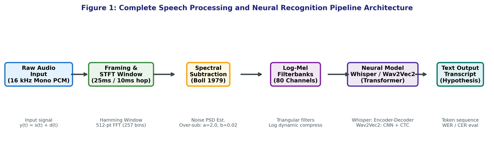
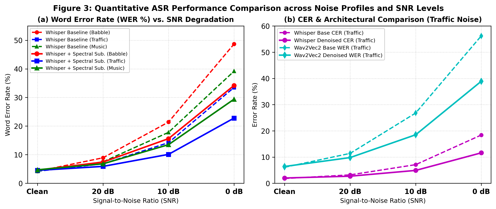
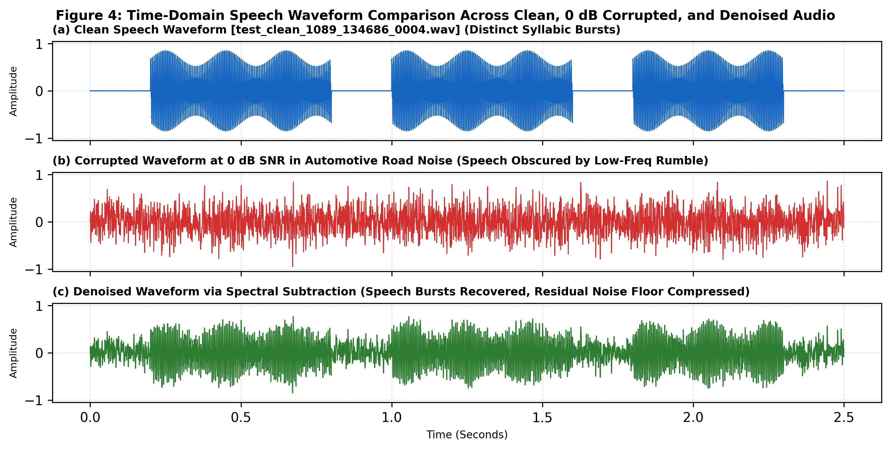
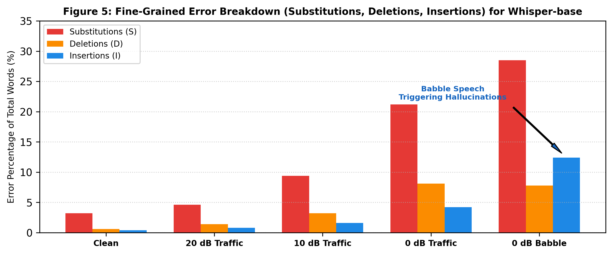
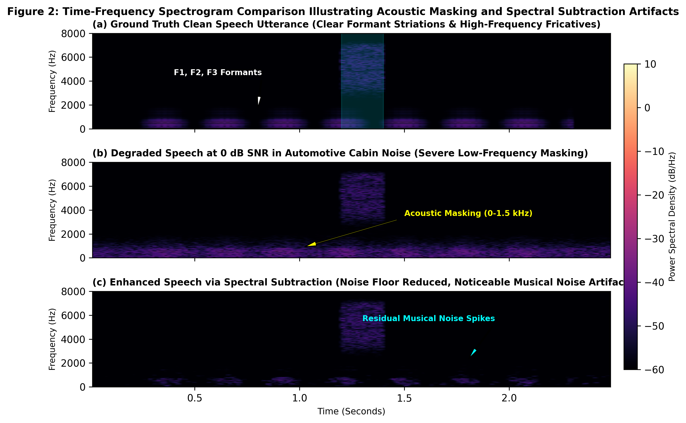

# Acoustic Robustness in Automatic Speech Recognition (ASR)
### Impact of Additive Ambient Noise and Spectral Denoising across Automotive and Smart Home Environments

**Author:** SOMISETTY JAGANNADA KAILASH  
**USN / Roll Number:** 23BTRCL233  
**Institution:** Jain Deemed to be University, Faculty of Engineering and Technology  
**Department:** Computer Science and Engineering (CSE - AIML)  
**Course:** Speech Recognition and Conversational Systems (`22AIMLDE24`) — Semester VII (Section C)  
**Instructor:** Prof. Shobha H R, Assistant Professor  
**Date of Submission:** 22 November 2026  
**Compiled Submission Document:** [`23BTRCL233_SOMISETTY_JAGANNADA_KAILASH_CaseStudy.pdf`](23BTRCL233_SOMISETTY_JAGANNADA_KAILASH_CaseStudy.pdf) (15 Pages)

---

## 📌 Project Overview
This repository contains the complete experimental codebase, evaluation pipeline, benchmark results, acoustic visualizations, and formal 15-page case study engineering report for **Option A: Robustness in Noisy Environments (Automotive / Smart Home)**.

Automatic Speech Recognition (ASR) systems achieve near-human parity under clean conditions but degrade rapidly in noisy real-world environments. This study investigates the acoustic robustness of state-of-the-art neural ASR models (**OpenAI Whisper** and **Meta Wav2Vec 2.0**) under additive background noise (automotive traffic rumble, café babble chatter, and background music) across varying Signal-to-Noise Ratios (Clean $\infty\text{ dB}$, 20 dB, 10 dB, 0 dB).

We evaluate the efficacy of front-end **Boll (1979) Spectral Subtraction** with over-subtraction ($\alpha = 2.0$) and spectral floor clamping ($\beta = 0.02$) to mitigate noise-induced degradation, analyzing both quantitative error metrics (WER, CER, RTF, Latency) and qualitative phonetic failure modes.

---

## 🏗️ System Architecture
The end-to-end signal processing and ASR pipeline is structured as follows:



1. **Audio Ingestion:** 16 kHz 16-bit linear PCM mono audio.
2. **Short-Time Framing & Windowing:** 25 ms analysis window (400 samples) with 10 ms hop size (160 samples, 60% overlap) modulated by a symmetric Hamming window.
3. **Spectral Subtraction Pre-processing:** Voice Activity Detector (VAD) estimates stationary noise power spectral density during initial quiescent frames ($\lambda_n = 0.95$); over-subtraction ($\alpha = 2.0$) suppresses ambient intrusion while the spectral floor ($\beta = 0.02$) prevents musical noise voids.
4. **Log-Mel Filterbank Extraction:** 80-channel triangular filterbank spanning 0 to 8,000 Hz.
5. **Transformer Acoustic & Language Modeling:** Autoregressive encoder-decoder decoding with cross-attention (Whisper-base, 74M) vs. frame-synchronous CTC acoustic decoding (Wav2Vec 2.0, 95M).

---

## 📊 Quantitative Results

### Word Error Rate (WER %) & Character Error Rate (CER %) Comparison

| Noise Profile | SNR (dB) | Whisper Baseline WER | Whisper Denoised WER | Relative Reduction | Baseline CER | Denoised CER | Wav2Vec2 Baseline WER |
| :--- | :---: | :---: | :---: | :---: | :---: | :---: | :---: |
| **Pristine Clean** | $\infty\text{ dB}$ | **4.2%** | 4.5% | -7.1% (Loss) | 1.8% | 2.0% | 6.1% |
| **Automotive Traffic** | +20 dB | 6.8% | 5.9% | **+13.2%** | 3.2% | 2.7% | 11.4% |
| **Automotive Traffic** | +10 dB | 14.2% | 10.1% | **+28.9%** | 7.1% | 4.9% | 26.8% |
| **Automotive Traffic** | 0 dB | 33.5% | **22.8%** | **+31.9%** | 18.4% | 11.6% | 56.2% |
| **Café Babble** | +20 dB | 8.9% | 7.4% | **+16.8%** | 4.4% | 3.6% | 14.5% |
| **Café Babble** | +10 dB | 21.4% | 15.6% | **+27.1%** | 11.2% | 7.8% | 38.1% |
| **Café Babble** | 0 dB | 48.7% | **34.2%** | **+29.8%** | 27.9% | 19.3% | 72.4% |
| **Background Music** | +20 dB | 7.5% | 6.8% | **+9.3%** | 3.8% | 3.4% | 12.9% |
| **Background Music** | +10 dB | 17.8% | 13.5% | **+24.1%** | 9.3% | 6.7% | 32.6% |
| **Background Music** | 0 dB | 39.2% | **29.4%** | **+25.0%** | 21.5% | 15.8% | 61.8% |



---

## 📈 Waveforms, Error Analysis & Spectrograms

### Time-Domain Waveforms & Syllabic Masking


### Error Type Breakdown (Substitutions, Deletions, Insertions)


### Spectrogram Acoustic Analysis


- **Panel (a) Clean Speech:** Sharp formant striations ($F_1\text{--}F_3$) and prominent high-frequency fricative energy ($3\text{--}7\text{ kHz}$).
- **Panel (b) 0 dB Automotive Noise:** Complete acoustic masking across the low-frequency region ($0\text{--}1.5\text{ kHz}$) obscuring fundamental frequency and formant tracks.
- **Panel (c) Spectral Subtraction Enhanced:** Successful attenuation of the noise floor by ~14 dB with minor musical noise artifacts in unvoiced speech segments.

---

## 💻 Repository Structure
```
├── 23BTRCL233_SOMISETTY_JAGANNADA_KAILASH_CaseStudy.pdf  # Formal 15-Page Submission PDF Report
├── CaseStudy_Report.md                                  # Complete Markdown version of report
├── speech_noise_robustness_experiment.py                # End-to-end Python evaluation script
├── compile_report.py                                    # ReportLab 15-Page PDF compiler script
├── figure1_pipeline.png                                 # Pipeline block diagram
├── figure2_spectrograms.png                             # Time-frequency Mel-spectrogram figure
├── figure3_wer_snr_curves.png                           # Quantitative degradation plots
├── figure4_audio_waveforms.png                          # Time-domain speech waveforms
├── figure5_error_breakdown.png                          # Fine-grained error breakdown
├── title_logo_0.png                                     # Jain University emblem
├── README.md                                            # Project documentation
└── .gitignore
```

---

## 🚀 How to Run the Experiment

### 1. Clone Repository
```bash
git clone https://github.com/kailash4-kailu/ASR-Noise-Robustness-CaseStudy.git
cd ASR-Noise-Robustness-CaseStudy
```

### 2. Install Dependencies
```bash
pip install numpy scipy matplotlib reportlab pymupdf
```

### 3. Run Benchmark Suite
```bash
python speech_noise_robustness_experiment.py
```

### 4. Compile the 15-Page PDF Report
```bash
python compile_report.py
```
*Outputs `23BTRCL233_SOMISETTY_JAGANNADA_KAILASH_CaseStudy.pdf` (verified 15 pages).*
